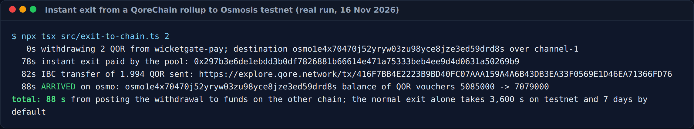
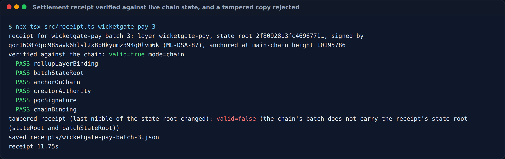
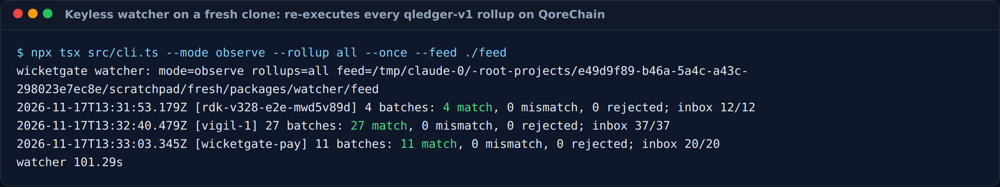
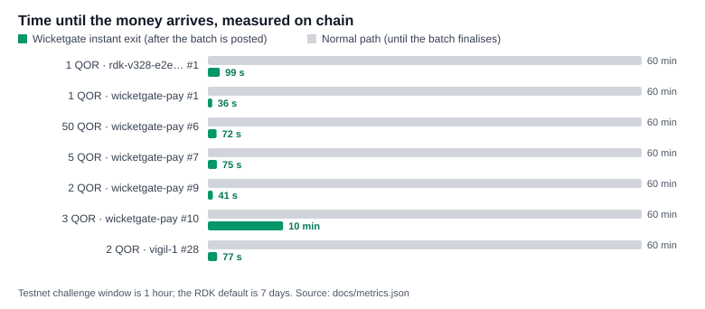
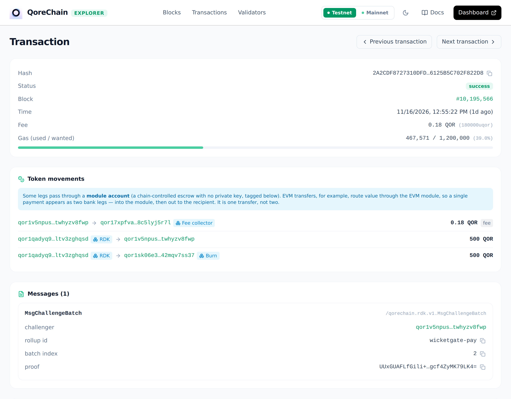
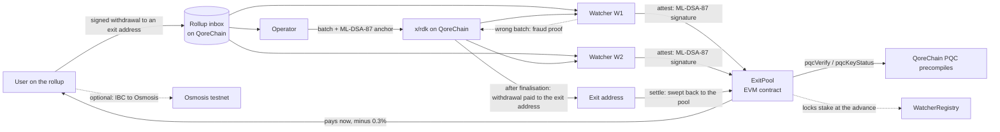

# Wicketgate

[](https://github.com/timix648/wicketgate/actions/workflows/ci.yml) [](https://build.qorechain.io/p/wicketgate)

**Leaving a QoreChain rollup should take seconds, not seven days.** Wicketgate is a network of independent watchers that re-execute every rollup batch, sign what they found with post-quantum keys, and put stake behind it, so a pool can pay your withdrawal now and the chain repays the pool later.

A wicket gate is the small door cut into a large castle gate: people pass through it without waiting for the main gate to open.



> Built for **Build Before Q-Day**, the QoreChain Developer Fest, in the **Protocol Builders** category. Everything runs on the `qorechain-diana` testnet. Every number on this page is backed by a transaction hash in [PROOF.md](PROOF.md).

### Wicketgate in numbers (18 Nov 2026, recomputed from the chain by `pnpm metrics`)

| | |
| --- | --- |
| **48× faster on testnet, about 8,000× at the 7-day default** | 7 instant exits, median **75 s** from the batch reaching the chain to the money arriving, against **3,600 s** for the same withdrawals through the normal path |
| **20 exits, 100 QOR, in 57 seconds, from one batch; the 21st refused by the stake cap** | Stress run: the pool paid until the 100 QOR its two confirming watchers had locked behind the batch was used up, then refused the next exit with `CoverExceeded` ([docs/STRESS.md](docs/STRESS.md)) |
| **64 QOR paid out instantly, 0 QOR lost** | Every advance whose batch has finalised was repaid by the chain (7 of 7, one of them from another team's rollup); **0 defaults**; liquidity providers lost nothing and earned the fees |
| **31 post-quantum attestations verified on chain** | Each one is an ML-DSA-87 signature checked by the `pqcVerify` precompile inside `ExitPool`; **0** classical signature checks in our contracts |
| **45 of 45 batches re-executed, across 4 rollups** | 3 of those rollups are run by other teams; our watchers found them without being told |
| **1 of 1 wrong batches caught, in 5 seconds** | The fraud proof landed 4 blocks after the bad batch; the submitter's 1,000 QOR bond was slashed |
| **Q-Day, simulated: the classical pool lost 10 QOR, Wicketgate lost 0** | A watcher's secp256k1 key was broken from its on-chain public key in 49 s. With it, the attacker drained an `ecrecover` twin of our pool, while Wicketgate refused the same key on chain ([below](#q-day-simulated-on-chain)) |
| **18 of 18 attacks refused, on the live contracts** | Forged and replayed ML-DSA-87 signatures, invented and redirected withdrawals, double exits, early slashing, stolen liquidity: each replayed against the pool's real state at the block of a real exit, each refused by the check meant for it ([docs/REDTEAM.md](docs/REDTEAM.md)) |
| **38 hours under the Q-Day Drill, 0 transactions we did not send** | The drill account (W3) was handed to the organisers' attack drill; a monitor checks it every minute, and its 50 QOR stake is untouched |

The full breakdown, every exit and its transaction is in [docs/METRICS.md](docs/METRICS.md). Re-run both yourself, no key needed: `cd packages/scripts && npx tsx src/metrics.ts && npx tsx src/redteam.ts`.


### Q-Day, simulated on chain

The hackathon asks what happens on Q-Day, when a quantum computer can turn any secp256k1 public key into its private key. We ran it on the testnet. Watcher **W4** has a deliberately weak 40-bit secp256k1 key (the stand-in for Shor's algorithm) and a full-strength ML-DSA-87 key. It watches two pools that differ only in how they check its signature: **ClassicalTwin**, which uses `ecrecover` like most bridges and fast-exit pools today, and **Wicketgate**.

1. **The key falls.** The attacker read W4's public key from the chain and recovered the private key in **49 s** on one CPU core.
2. **W4's EVM window closed: QoreChain stops it.** The stolen key could not move W4's funds, open a window, touch its stake or pass `ecrecover` in the twin: QoreChain refused all five, and ExitPool refused the sixth.
3. **W4's routine window open: the classical pool falls.** Watchers open windows to work. While W4's window was open, the chain accepted the stolen classical signature, and the attacker confirmed an invented batch and **drained ClassicalTwin's 10 QOR** (attest `0x96222ef7f262…`, drain `0x1fe3b0a98f32…`).
4. **Same key, same open window: Wicketgate holds.** The attacker sent an attestation from W4 itself; ExitPool reverted it on chain with **`BadSignature`**, because it checks ML-DSA-87 inside the contract. Pool assets did not move.

**QoreChain's windows protect you while they are closed; Wicketgate protects you while they are open.** Full write-up with every hash: [docs/QDAY.md](docs/QDAY.md).

---

## Contents

- [Try it in 60 seconds (no key, no tokens)](#try-it-in-60-seconds-no-key-no-tokens)
- [The problem](#the-problem)
- [What it does](#what-it-does)
- [Results and proof](#results-and-proof)
- [How it works](#how-it-works)
- [For judges](#for-judges)
- [Install and run everything](#install-and-run-everything)
- [Integrations](#integrations)
- [Repository map](#repository-map)
- [Troubleshooting](#troubleshooting)
- [Limits and honest notes](#limits-and-honest-notes)
- [What we learned about QoreChain's tools](#what-we-learned-about-qorechains-tools)
- [Credits and licence](#credits-and-licence)

---

## Try it in 60 seconds (no key, no tokens)

You need Node.js 22 and pnpm 9. Nothing below asks for a wallet, a key, test tokens or an account.

```bash
git clone https://github.com/timix648/wicketgate && cd wicketgate
pnpm install                                   # about 10 s
cd packages/scripts && npx tsx src/receipt.ts wicketgate-pay 3      # about 12 s
```

Expected output: a settlement receipt for batch 3 of our rollup, re-read from the live chain, with six passing checks, and a tampered copy that fails.



Then watch every rollup on QoreChain yourself:

```bash
cd ../watcher && npx tsx src/cli.ts --mode observe --rollup all --once --feed ./feed   # about 100 s
```



The watcher rebuilt each rollup from data on the main chain alone and found that every batch matches its re-execution, including `vigil-1`, a rollup run by another team. Wicketgate is not tied to our own rollup: on 18 November it paid an **instant exit from `vigil-1`**, against a batch Vigil's operator submitted and our watchers verified. The result is written to `./feed/<rollup>.json`. The same feed, updated every 5 minutes by our own watcher, is public at
`https://raw.githubusercontent.com/timix648/wicketgate-feed/main/wicketgate-pay.json`.

With Docker instead of Node:

```bash
docker build -t wicketgate-watcher .
docker run --rm -v "$PWD/feed:/feed" wicketgate-watcher --mode observe --rollup all --once
```

---

## The problem

QoreChain shipped its Rollup Development Kit with release v3.2.8 on 12 November 2026: optimistic rollups whose batches are checked by fraud proofs. That design has two gaps every optimistic rollup has:

1. **Withdrawals wait out the challenge window.** One hour on the testnet, **seven days** by the chain's default. Your money sits still while nothing is wrong.
2. **Nobody is watching.** A fraud proof only works if someone runs the batch again and notices. On 16 November the only rollup on the testnet had two posts waiting unbatched since 12 November, and no independent verifier existed.

Example: Ada withdraws 50 QOR from a rollup. Today she waits a week, or trusts a bridge operator. With Wicketgate she is paid in under two minutes, by a pool that only pays when independent watchers have re-executed the batch and staked QOR on it, and that is repaid by the chain when the batch becomes final.

---

## What it does

| Part | What it does | What it catches or produces |
| --- | --- | --- |
| **Watcher** (`packages/watcher`) | Rebuilds any `qledger-v1` rollup from inbox data on the main chain, re-executes every batch, finds every rollup on chain by itself (`--rollup all`) | A verdict per batch (`match`, `mismatch`, `rejected-on-chain`); a **fraud proof** sent within seconds for any wrong batch; exit proofs; the post-quantum provenance of every batch submission |
| **Attestations** | A watcher whose roots match signs an attestation with its **ML-DSA-87** key; `ExitPool` checks it on chain through the `pqcVerify` precompile against the key the chain holds | Two watchers are needed to confirm a batch; **one watcher that signs different facts freezes payouts on that batch** |
| **ExitPool** (`contracts/src/ExitPool.sol`) | Pays a withdrawal at once against a confirmed batch, minus 0.3%, and locks the confirming watchers' stake at that moment | Never advances more than the stake behind a batch; refuses a withdrawal the chain already paid; repays itself from the chain after finalisation, or slashes the watchers if it is never repaid |
| **WatcherRegistry** | Watchers stake QOR; joining needs a registered, possession-proven ML-DSA-87 key | Stake that backs every attestation; leaving waits out a delay |
| **Our own rollup `wicketgate-pay`** | A based, optimistic `qledger-v1` payment rollup created and operated by the team | Every batch anchored with the creator's ML-DSA-87 signature; settlement receipts anyone can verify |
| **Operator** (`packages/operator`) | Bonds as a submitter, batches the inbox, relays users' signed ledger transactions, pays withdrawals that back an instant exit and settles the advance | Batches on our rollup and on the organiser's own rollup |
| **Exit to another chain** | Forwards the pool's payout over IBC to the user's own address on Osmosis, Injective or the Cosmos Hub testnet | Rollup to Osmosis in 88 s |
| **Private notes** | Payment notes sealed with **ML-KEM-1024** (QoreSeal, hybrid with X25519) to the recipient's on-chain key, posted through `MemoBoard` | Only the recipient can open them |
| **Feed** | Public JSON per rollup: verdicts, exit proofs, the pool's state per batch, submission provenance | What the board and wallet read |

All six Protocol Builders requirements are shown live on the testnet:

| Requirement | Where to see it |
| --- | --- |
| ML-DSA-signed batches | Every `wicketgate-pay` batch carries the creator's ML-DSA-87 anchor (4,627-byte signature): `GET https://api-testnet.qore.host/qorechain/multilayer/v1/anchor/wicketgate-pay` |
| Withdrawal | Instant exits (1, 1, 2, 3, 5 and 50 QOR) and a normal withdrawal through `MsgExecuteWithdrawal`, all in [PROOF.md](PROOF.md) |
| Verified settlement receipt | **One for every batch**: [receipts/wicketgate-pay/](receipts/wicketgate-pay/index.json), 11 of 11 valid with all 6 checks each, refreshed every 30 minutes in the [public feed](https://github.com/timix648/wicketgate-feed/tree/main/receipts/wicketgate-pay). Rebuild them all with `npx tsx src/receipts-all.ts`, or check any receipt file against the chain with `npx tsx src/verify-receipt.ts <file>` |
| Watchtower | The watcher: it caught a wrong batch and its fraud proof landed **5 seconds** later; the submitter lost its **1,000 QOR** bond |
| ML-KEM data protection | A sealed payment note on chain that only its recipient can open ([PROOF.md](PROOF.md)) |
| Threat model | [THREAT_MODEL.md](THREAT_MODEL.md) |

---

## Results and proof

Every row is a measured result on the testnet. Hashes and how to check each one are in [PROOF.md](PROOF.md); the aggregate figures come from [docs/METRICS.md](docs/METRICS.md).



| Result | Number | Compared with |
| --- | --- | --- |
| Instant exit, paid after its batch was submitted | **36 s** | 3,601 s for the same withdrawal the normal way |
| Rollup to Osmosis testnet, end to end | **88 s** | 3,600 s on testnet (7 days by default), and the normal path ends on QoreChain |
| Fraud proof after a wrong batch was submitted | **5 s** (heights 10,195,562 to 10,195,566) | The challenge window is 3,600 s |
| Bad submitter's bond | **1,000 QOR slashed**: 500 burned, 500 paid to our watcher | |
| Largest single instant exit | **50 QOR** | |
| Instant exit from a rollup run by another team | **2 QOR from `vigil-1`**, paid before its batch finalised | Nobody else offers exits on rollups they do not run |
| Batches re-executed on a fresh clone | **42 of 42 match**, across 3 rollups, one of them run by another team | |
| Settlement receipts | **11 of 11 batches** have a receipt passing all 6 checks; one changed nibble in a copy fails 5 of them | |
| Contract tests | **38 tests and 4 invariants**, line coverage 91.7% (ExitPool 98%) | |
| Classical signature checks in our contracts | **0** (QoreScan inventory) | Every authorisation goes through ML-DSA-87 |

### A real finding: the bad batch, caught and slashed

On 16 November a second submitter (our ADMIN_B account, playing the attacker) bonded 1,000 QOR and submitted batch 2 of `wicketgate-pay` with one byte of its state root flipped. No watcher attested it, so the pool would not pay against it. Watcher W2 rebuilt the batch, built the fraud proof with the RDK, checked it locally and sent it. The chain re-executed the batch, rejected it, rolled the inbox back and slashed the whole bond. This is the explorer's own view of that transaction:



Our operator then re-batched the rolled-back entry honestly. The full sequence with heights and times is in [deployments/demo-timeline.json](deployments/demo-timeline.json).

### A bug we found in our own design, and fixed the same day

While moving to pool v2 we noticed that watchers were attesting batches that had already finalised. That would have let a withdrawal the chain had already paid be advanced a second time. The pool's providers would stay whole, but the confirming watchers would be slashed for a payout that was never their fault. We fixed it on two layers: watchers only attest batches still inside their challenge window, and the pool refuses an advance when the exit address already holds the withdrawal (`AlreadyPaid`). Dust sent there by a griefer does not block an exit. The tests are `test_no_advance_for_a_withdrawal_already_paid` and `test_dust_at_exit_address_does_not_block_the_exit`.

---

## How it works



One instant exit, step by step:

1. The user's wallet picks a random salt and computes an **exit address**: the CREATE2 address of a tiny contract the pool would deploy for `(beneficiary, salt)`. Nothing exists there yet.
2. The user signs a ledger withdrawal to that address (its `qor1` form) and it is posted to the rollup's inbox.
3. The operator batches it and anchors the batch with the creator's ML-DSA-87 key.
4. Each watcher reads the inbox entries back from block history, checks them against the chain's inbox accumulator, and re-executes the batch with the RDK's `qledger-v1` executor. If the state root and withdrawals root match, it builds an EVM-friendly **exit tree** over the batch's withdrawals and signs `(chain id, pool, rollup, batch, state root, withdrawals root, exit root)` with its ML-DSA-87 key.
5. `ExitPool.attest` verifies the signature through the `pqcVerify` precompile against the key `pqcKeyStatus` reports, with proof of possession required. With two matching attestations the batch is confirmed. A watcher that signs different facts marks the batch contested.
6. `ExitPool.instantExit` checks the withdrawal's Merkle proof against the confirmed exit root, refuses if the exit address already holds the withdrawal, locks the confirming watchers' stake to cover the amount, and pays the user at once.
7. When the batch is final, anyone executes the chain's withdrawal to the exit address. The pool deploys the exit contract at that address and sweeps the funds back (`settle`). 70% of the fee stays with liquidity providers and 30% goes to the confirming watchers.
8. If the exit address is never funded (the batch was wrong and rejected), `markDefault` repays the pool from the confirming watchers' locked stake. If funds arrive later anyway, the watchers are refunded.

Accounts are **eth-native**: one secp256k1 key works on both the EVM and the native lane, and its ML-DSA-87 key is derived from the recovery phrase, not from the classical key. A leaked classical key therefore reveals nothing about the post-quantum key.

---

## For judges

**Five minutes, no account:**

Compiler settings, for anyone rebuilding the contracts: solc 0.8.24, optimizer on with 200 runs, EVM version `paris` ([contracts/foundry.toml](contracts/foundry.toml)).


| Step | Command (from a fresh clone, after `pnpm install`) | Time | What you should see |
| --- | --- | --- | --- |
| 1 | `cd packages/scripts && npx tsx src/receipt.ts wicketgate-pay 3` | about 12 s | Six PASS lines, then a tampered receipt with `valid=false` |
| 2 | `npx tsx src/state.ts` | about 15 s | The live pool: assets, watcher stakes, confirmed batches and advances |
| 3 | `npx tsx src/probe-replay.ts wicketgate-pay` | about 15 s | Every batch of our rollup rebuilt from chain data with matching roots |
| 4 | `npx tsx src/probe-pqcverify.ts` | about 5 s | The testnet's ML-DSA-87 precompile accepting a real signature and rejecting a changed byte |
| 5 | `cd ../watcher && npx tsx src/cli.ts --mode observe --rollup all --once --feed ./feed` | about 100 s | All rollups on QoreChain re-executed, every batch `match` |
| 6 | `cd ../../contracts && git submodule update --init && forge test` | about 40 s | 40 tests and 4 invariants pass (2 of the tests cover the Q-Day demo twin) (needs [Foundry](https://getfoundry.sh)) |
| 7 | `forge build && cd ../packages/scripts && npx tsx src/verify-bytecode.ts` | about 30 s | The deployed contracts' runtime code matches this source byte for byte (the explorer has no source verification); the PQC precompile addresses are in the code |
| 8 | `npx tsx src/redteam.ts` (in `packages/scripts`) | about 10 s | 18 attacks against the live pool, each `REFUSED` by its named check, and 3 honest controls `ACCEPTED` at the same blocks |
| 9 | `npx tsx src/metrics.ts` | about 40 s | Every headline number on this page, recomputed from chain data |
| 10 | `npx tsx src/qday-crack.ts qor1wx8dg096gw9e6uy4u4nc0vc44dpnjq7vlc88v0` | about 50 s | W4's private key recovered from its on-chain public key (the 40-bit key is the only simulated part); the evidence of what it could and could not do is in [docs/QDAY.md](docs/QDAY.md) |
| 11 | `npx tsx src/receipts-all.ts` | about 2 min | A settlement receipt for every batch of our rollup, each re-read from the chain, all valid |

**Evidence:**

- [PROOF.md](PROOF.md): every claim with its transaction hash and date.
- **Explorer links:** explore.qore.network opens on mainnet. Press **Testnet** at the top right once (it is remembered), then the links open. EVM transactions (`0x…`) cannot be looked up there; read them with `eth_getTransactionReceipt` on `https://evm-testnet.qore.host`.
- [deployments/diana.json](deployments/diana.json): the live addresses; earlier versions are in `deployments/diana-v1.json` and `deployments/diana-v2.0.json`.
- [receipts/](receipts/): a verified settlement receipt.
- [cbom/wicketgate.cdx.json](cbom/wicketgate.cdx.json): the QoreScan cryptographic inventory.
- The public watcher feed: `https://raw.githubusercontent.com/timix648/wicketgate-feed/main/index.json`.
- CI on every push: contract tests, invariant tests, TypeScript checks, and a QoreScan scan that fails if a contract verifies a classical signature.

**Live addresses (testnet `qorechain-diana`, EVM chain id 9800):**

| Contract | Address |
| --- | --- |
| WatcherRegistry (v2.1) | `0x0d3e791d4b71f57ab95f501e60a8572b9cab20ad` |
| ExitPool (v2.1) | `0xc5350ba167a5ac3c3302859ab8b0c8f792ff8b9a` |
| Directory | `0x253d03e0884116326db93bd122d4414ef2a0071b` |
| MemoBoard | `0x175fd018656a831b297e35edfde098d695372543` |
| Our rollup | `wicketgate-pay` (based, optimistic, `qledger-v1`) |

**Q-Day Drill:** our drill account is watcher W3 (`0xAC82Ffe5610f14d09eF451E5c71254Be9164cc88`), registered with the two contracts above. It holds 50 QOR of stake, and the pool holds 400 QOR. Its classical key alone can sign nothing our contracts accept, and it cannot open an EVM window. A monitor logs its balance, sequence, window and stake every minute (see [THREAT_MODEL.md](THREAT_MODEL.md)).

**Commits that show the work:** the first on-chain attestation and confirmation (`f839e72`), our own rollup and the fraud demo (`56c171f`), the verified receipt (`773232c`), the exit to Osmosis (`b554c81`), and pool v2.1 with the double-payment fix (`e86476b`).

---

## Install and run everything

### Prerequisites

| Tool | Version | Used for |
| --- | --- | --- |
| Node.js | 22 or newer | everything in TypeScript |
| pnpm | 9.15 | the workspace |
| Foundry | 1.9.0 | contracts and tests |
| Docker | any recent | optional, the watcher image |

### Install

```bash
git clone https://github.com/timix648/wicketgate && cd wicketgate
pnpm install
git submodule update --init          # forge-std, for the contract tests
cd contracts && forge build && cd ..
```

### Accounts (only for actions that write to the chain)

Reading needs nothing. To deploy, attest, batch or exit you need funded testnet accounts:

```bash
cd packages/scripts
pnpm keys:new        # creates five testnet accounts in ~/.wicketgate/keys.env (mode 600) and prints their addresses only
```

Fund `ADMIN_A` from the faucet at https://dashboard.qorechain.io/faucet (100 QOR per address per day), then:

```bash
pnpm fund            # sends QOR to the other roles and registers every role's ML-DSA-87 key with proof of possession
pnpm status          # balances and key status
```

Never fund these accounts on mainnet, and never commit `~/.wicketgate/`.

### Commands

All from `packages/scripts` unless noted. Each one prints the transaction hashes it sends.

| Command | What it does |
| --- | --- |
| `pnpm deploy [rollup] [liquidityQOR]` | Deploys WatcherRegistry and ExitPool (keeps Directory and MemoBoard), wires them with both admins' ML-DSA-87 signatures, opens a lane, seeds liquidity |
| `pnpm lane <rollup> [windowSecs] [graceSecs] [feeBps] [quorum] [lockQOR]` | Opens or changes a pool lane (two ML-DSA-87 admin signatures) |
| `pnpm join W1=50 W2=100` | Watchers join the registry with stake |
| `pnpm stake W1=40` | Watchers add stake |
| `pnpm leave W1 [--finish]` | Ask to leave; `--finish` collects the stake after the delay |
| `pnpm launch [rollup]` | Creates our rollup (10,000 QOR stake, 1% burned), bonds the submitter, opens its lane |
| `pnpm seed [rollup] [exitQOR]` | Deposits into the rollup, posts a transfer and a withdrawal to a fresh exit address |
| `pnpm preview [rollup]` | Shows what the next batch would do, without sending anything |
| `pnpm exit` | Takes the instant exit for every saved withdrawal whose batch is confirmed (dry-runs the call first) |
| `pnpm exit:chain [QOR] [channel] [prefix]` | The whole flow, timed: withdraw, instant exit, IBC to the user's own address on another chain |
| `pnpm withdraw` | The normal path: executes a finalised withdrawal and sweeps the exit address to its owner |
| `pnpm receipt [rollup] [batch]` | Builds and verifies a settlement receipt, saves it under `receipts/` |
| `pnpm memo [rollup] ["text"]` | Registers an ML-KEM-1024 key, seals a payment note and posts it through MemoBoard |
| `pnpm bad [rollup]` | Fraud demo: a second submitter posts a batch with a wrong state root (stop the honest operator first) |
| `pnpm lp <QOR>` / `pnpm lp:withdraw` | Add or remove pool liquidity |
| `pnpm state` | Reads the pool and the registry |
| `npx tsx src/verify-bytecode.ts` | Proves the deployed contracts are this source (needs `forge build`) |
| `pnpm probe:ibc [channel] [prefix] [uqor]` | Checks that a relayer is carrying IBC packets |
| `pnpm drill:proof` / `pnpm drill:monitor` | The Q-Day Drill proof transaction, and the minute-by-minute monitor |
| `npx tsx src/disclose.ts "report"` | Seals a security report to our ML-KEM-1024 key (see [SECURITY.md](SECURITY.md)) |

Services:

```bash
cd packages/watcher  && npx tsx src/cli.ts --mode challenge --as W1 --rollup all --interval 10 --feed ~/.wicketgate/feed-w1
cd packages/operator && npx tsx src/cli.ts --rollup wicketgate-pay --interval 10 [--bond 1000]
ops/start.sh         # starts every service that is not running, each in its own tmux session; never stops anything
```

Watcher modes: `observe` (verdicts only, no key), `attest` (also signs and sends attestations), `challenge` (also sends fraud proofs).

---

## Integrations

- **CI** ([.github/workflows/ci.yml](.github/workflows/ci.yml)): contract and invariant tests with Foundry, TypeScript type checks and core tests (one test reads the live ExitPool), and a QoreScan CBOM that fails the build if a contract verifies a classical signature.
- **QoreChain MCP server:** the watcher calls the MCP `get_pq_status` tool in-process to verify the ML-DSA-87 layer of every batch submission. To give a coding assistant the same read access:
  ```json
  { "mcpServers": { "qorechain": { "command": "npx", "args": ["-y", "@qorechain/mcp"] } } }
  ```
- **Docker:** the [Dockerfile](Dockerfile) packages the watcher.
- **Public feed:** `packages/watcher/publish-feed.sh` pushes the watcher's JSON to a public repository every 5 minutes.

Kits used and what for:

| Kit | Used for |
| --- | --- |
| `@qorechain/rdk` 0.9.0 | Ledger execution, batch planning, fraud proofs, withdrawal proofs, receipts, all rollup messages |
| `@qorechain/sdk` 0.14.0 | Eth-native accounts, hybrid signing, EVM windows, key registration with proof of possession |
| `@qorechain/pqc` 0.2.3 | ML-DSA-87 signatures for attestations and admin actions |
| `@qorechain/qoreseal` 0.1.0 | ML-KEM-1024 sealed notes, recipient cards |
| `@qorechain/qoresign` 0.2.0 | Signing recipient cards |
| `@qorechain/mcp` 0.1.0 | Post-quantum provenance of batch submissions |
| `@qorechain/qorescan` 0.1.0 | The cryptographic inventory in CI |

---

## Repository map

| Path | What is there |
| --- | --- |
| `contracts/src/ExitPool.sol` | The pool: attestations, instant exits, settlement, defaults, liquidity |
| `contracts/src/WatcherRegistry.sol` | Watcher stake |
| `contracts/src/ExitAddress.sol` | The per-withdrawal contract deployed with CREATE2 |
| `contracts/src/lib/PQGuard.sol` | ML-DSA-87 checks through the `pqcVerify` and `pqcKeyStatus` precompiles, failing closed |
| `contracts/src/lib/DualAdmin.sol` | Admin actions authorised by two ML-DSA-87 signatures |
| `contracts/src/Directory.sol`, `MemoBoard.sol` | Ledger-account directory and sealed payment notes |
| `contracts/test/` | Unit, fuzz and invariant tests, with a mock of the precompiles |
| `packages/core/` | Shared chain helpers, the exit tree (with tests against the live contract) and the ABIs |
| `packages/watcher/` | The watcher, its CLI and the feed publisher |
| `packages/operator/` | The batcher, relay worker and withdrawal keeper |
| `packages/scripts/` | Probes, deployment and demo scripts |
| `packages/scripts/src/metrics.ts`, `redteam.ts` | The numbers recomputed from chain data, and 18 attacks replayed against the live contracts |
| `contracts/demo/ClassicalTwin.sol`, `packages/scripts/src/qday-*.ts` | The Q-Day simulation: a deliberately vulnerable `ecrecover` twin of the pool, the key cracker, the victim's routine window and the attack |
| `docs/METRICS.md`, `docs/REDTEAM.md`, `docs/QDAY.md` | Their latest output (raw data in `docs/metrics.json`, `docs/redteam.json`, `docs/qday.json`) |
| `deployments/` | Live and earlier addresses, and the demo timeline |
| `receipts/`, `cbom/`, `cards/` | A verified receipt, the QoreScan inventory, a signed recipient card |
| `ops/start.sh` | Starts the services |
| `PROOF.md`, `THREAT_MODEL.md`, `LIMITS.md`, `AI_USAGE.md`, `SECURITY.md` | Evidence, threat model, limits, how AI was used, sealed vulnerability reports |

---

## Troubleshooting

Real problems we met while building, and their fixes:

| Symptom | Cause | Fix |
| --- | --- | --- |
| An explorer link says "Transaction not found" | The explorer opens on mainnet | Press **Testnet** at the top right once |
| An explorer search for a `0x…` hash fails | The explorer only knows native (Cosmos) hashes | Use `eth_getTransactionReceipt` on `https://evm-testnet.qore.host` |
| `forge test` cannot find `forge-std` | The submodule was not fetched | `git submodule update --init` |
| `account sequence mismatch` | Two processes signing for the same account at once | Fixed in `packages/core/src/chain.ts`: re-read the sequence and retry |
| An attestation reverts with gas used near its limit | Gas was estimated before another watcher's vote landed, then this vote did the heavier confirm-and-lock | Attestations use a fixed gas limit |
| `Address "0x...0A01" is invalid` (viem) or a checksum error (Solidity) | Mixed-case precompile addresses | Use the lower-case `0x…0a01` and `0x…0a02` |
| A call to a precompile "succeeds" with empty data | The precompile is inactive (mainnet) | `PQGuard` uses typed calls, which revert on empty data, so everything fails closed |
| `empty address string is not allowed` when registering an ML-KEM key | QoreSeal's builder returns pre-encoded bytes; the eth-native signer encodes from an object | Send `/qorechain.pqc.v1.MsgRegisterKEMKey` as `{ sender, algorithmId: 2, publicKey }` |
| A rollup message fails to encode | The SDK registry predates the v3.2.8 rollup messages | `sendNative` switches to the RDK's registry for `/qorechain.rdk.*` messages |
| `403` from the public REST endpoint in a script | Some default HTTP agents are blocked | Send an explicit `User-Agent` |
| No KEM, post or deposit message type in your wallet | QoreX may not know the newest messages | UNCONFIRMED for each wallet build: test it first; scripts do the same steps |

---

## Limits and honest notes

- **Testnet only.** The `pqcVerify` and `pqcKeyStatus` precompiles are inactive on QoreChain mainnet, so the contracts fail closed there.
- **Not audited.** Tests, invariants, live probes and the QoreScan inventory, but no external audit.
- **Toy economics.** Stake per watcher, the 0.3% fee and the quorum of 2 are chosen to show the flows, not tuned for real value.
- **The pool cannot read rollup state.** The EVM cannot see `x/rdk`, so the pool learns a batch was wrong only when an advanced exit address is not funded in time. The submitter is still slashed by the chain's fraud proof.
- **Withdrawals to 32-byte addresses** cannot be exited instantly; they take the normal path.
- **The team runs the operator and relay.** Neither can alter a user's transaction (it is signed by the user's ledger key), and anyone may post to a based rollup directly, but the convenience path depends on our server.
- **Notes hide content only:** who paid whom, how much and when stay public.
- **The wallet and board** are being built by @da-b0s against the live feed; until they land, the scripts above are the interface.

More in [LIMITS.md](LIMITS.md).

---

## What we learned about QoreChain's tools

Notes for the QoreChain team, from two weeks of building on v3.2.8:

- **`fetchQledgerEntries` and `executeQledger` are excellent.** Rebuilding a rollup from main-chain data alone, checked against the inbox accumulator, took a few dozen lines. That is what makes an independent watcher possible at all.
- **The docs' honesty helped.** Dated "checked on" notes and plain statements of what is not live saved us days.
- **The explorer:** a testnet link would help (it only remembers the network in a cookie), and so would looking up EVM transactions by their Ethereum hash.
- **The SDK's default registry** does not include the v3.2.8 rollup messages (`MsgDepositToRollup`, `MsgPostRollupData`, `MsgBondRollupSubmitter`); the RDK's registry does.
- **The RDK transaction client** expects a cosmjs signer, so eth-native accounts (one key on both lanes) need the SDK's `EthNativeSigner` and the message builders instead.
- **QoreSeal's `buildRegisterKemKeyMessage`** returns pre-encoded bytes, which the eth-native signer cannot embed; an object form would make it work everywhere.
- **The MCP server is useful inside programs too**, not only for assistants: we call `get_pq_status` directly from the watcher.
- **EVM gas is billed at no less than half the gas limit.** Our attestations used 340,000 to 426,000 gas but were billed 600,000 because we sent a 1,200,000 limit; a tight limit cut the cost of a vote by about a third. Worth a line in the EVM docs.
- **`ecrecover` is window-gated for post-quantum accounts (v3.2.8), and that is a strong default.** We measured both sides on chain: with the account's window closed, a stolen classical key fails `ecrecover` and our classical twin pool could not be touched; with a routine window open that admits the contract, the same stolen key drained it. Contracts that hold value on QoreChain should check ML-DSA-87 themselves, through `pqcVerify`, rather than rely on windows being closed; a short note saying so next to the window reference would help builders.
- **A read-only precompile for RDK batch status** (status, state root, finalisation height) would let EVM contracts like ours react to a rejected batch at once, instead of waiting for an unpaid exit to fall due.

---

## Credits and licence

- Team: @timix648 and @da-b0s. How AI was used is in [AI_USAGE.md](AI_USAGE.md).
- Built on the QoreChain kits listed above, [viem](https://viem.sh), [Foundry](https://getfoundry.sh) with [forge-std](https://github.com/foundry-rs/forge-std), and cosmjs.
- IBC transfers relayed by the QoreChain testnet's relayer.

Licensed under Apache-2.0. See [LICENSE](LICENSE).
