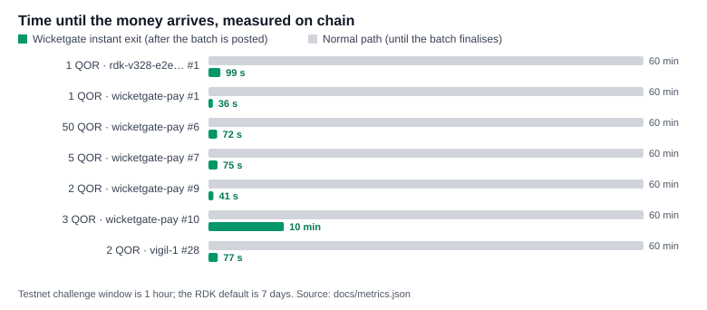

# Wicketgate in numbers

Generated 2026-11-19T22:03:33.983Z from public chain data at EVM block 10,396,484 by `npx tsx packages/scripts/src/metrics.ts`. Nothing here is typed in by hand: the script reads the event logs of all three ExitPool deployments, the RDK batch records, block times and the published watcher feed. The raw numbers are in [metrics.json](metrics.json).

## Speed

| | |
| --- | --- |
| Instant exits paid | **28** |
| Median time from the batch reaching the chain to the money arriving | **71 s** (slowest 10 min) |
| Median time from the withdrawal request to the money arriving | **96 s** |
| Same withdrawals through the normal path (measured batch finalisation) | 60 min |
| Faster on testnet (1-hour challenge window) | **51.06×** |
| Faster at the RDK's default 7-day window | **8,579×** |

## Money

| | |
| --- | --- |
| QOR paid out instantly | **166 QOR** (largest single exit 50 QOR) |
| Advances whose batch has finalised | 28, of which repaid: **28** |
| Defaults | **0** |
| Losses for liquidity providers | **0 QOR** |
| Fees charged (0.3%) | 0.498 QOR |
| Median time from advance to the pool being repaid | 60.77 min |
| Median gas cost of an instant exit | 0.050625 QOR |
| Liquidity in the live pool | 400.2247 QOR |

## Post-quantum security

| | |
| --- | --- |
| Watcher attestations whose ML-DSA-87 signature was verified on chain (`pqcVerify`) | **39**, from 2 watchers |
| Batches confirmed by a quorum of PQ-signed attestations | 19 |
| Average gas of one attestation, signature check included | 540,733 |
| Batch submissions whose ML-DSA-87 layer the watchers checked (MCP `get_pq_status`) | 105 |
| Classical signature checks (`ecrecover`) in our contracts | **0** ([CBOM](../cbom/wicketgate.cdx.json)) |

## Independent verification

| | |
| --- | --- |
| Rollups our watchers follow | **6**, of which 5 we do not run |
| Batches re-executed from chain data | **105** (104 match) |
| Wrong batches kept on record after the chain replaced them | 11 |

## Fraud

| | |
| --- | --- |
| Wrong batches submitted in the demo | 1; caught **1** |
| Time from the wrong batch to the upheld fraud proof | **5 s** (4 blocks) |
| Bond slashed | 1000 QOR: 500 burned, 500 paid to the watcher |
| Honest watchers slashed | 0 |

## Q-Day Drill (the drill account, W3)

| | |
| --- | --- |
| Watched | 2026-11-16T20:15:27.435Z to 2026-11-19T22:03:08.841Z (73.79 h, 4,369 snapshots) |
| Transactions from the drill account that were not ours | **0** |
| Drill account's stake now | 50 QOR |

## Every instant exit

| Batch | Pool | QOR | Paid after batch posted | Normal path | Repaid | Exit tx |
| --- | --- | --- | --- | --- | --- | --- |
| rdk-v328-e2e-mwd5v89d #1 | v1 | 1 | 99 s | 60 min | yes | `0x837118d20f…` |
| wicketgate-pay #1 | v1 | 1 | 36 s | 60 min | yes | `0x22c2ce760d…` |
| wicketgate-pay #6 | v1 | 50 | 72 s | 60 min | yes | `0x2b196f9005…` |
| wicketgate-pay #7 | v1 | 5 | 75 s | 60 min | yes | `0x9f40176fa3…` |
| wicketgate-pay #9 | v1 | 2 | 41 s | 60 min | yes | `0x297b3e6de1…` |
| wicketgate-pay #10 | v2.1 | 3 | 10 min | 60 min | yes | `0xa4e4fd21cc…` |
| vigil-1 #28 | v2.1 | 2 | 77 s | 60 min | yes | `0x4e0914e372…` |
| wicketgate-pay #11 | v2.1 | 5 | 42 s | 60 min | yes | `0x9de2721472…` |
| wicketgate-pay #11 | v2.1 | 5 | 45 s | 60 min | yes | `0x51f6d81875…` |
| wicketgate-pay #11 | v2.1 | 5 | 48 s | 60 min | yes | `0x173c2f9b89…` |
| wicketgate-pay #11 | v2.1 | 5 | 50 s | 60 min | yes | `0xb0218036f0…` |
| wicketgate-pay #11 | v2.1 | 5 | 53 s | 60 min | yes | `0x2c805d77dc…` |
| wicketgate-pay #11 | v2.1 | 5 | 56 s | 60 min | yes | `0x750fe88d18…` |
| wicketgate-pay #11 | v2.1 | 5 | 59 s | 60 min | yes | `0x6418cc8164…` |
| wicketgate-pay #11 | v2.1 | 5 | 62 s | 60 min | yes | `0x86010cfd3e…` |
| wicketgate-pay #11 | v2.1 | 5 | 65 s | 60 min | yes | `0x12f8eb1f9b…` |
| wicketgate-pay #11 | v2.1 | 5 | 68 s | 60 min | yes | `0x97984a4759…` |
| wicketgate-pay #11 | v2.1 | 5 | 69 s | 60 min | yes | `0x2dab5cd1bd…` |
| wicketgate-pay #11 | v2.1 | 5 | 72 s | 60 min | yes | `0xa3c37aa1a3…` |
| wicketgate-pay #11 | v2.1 | 5 | 75 s | 60 min | yes | `0xc26d65be18…` |
| wicketgate-pay #11 | v2.1 | 5 | 78 s | 60 min | yes | `0x6f541dab3f…` |
| wicketgate-pay #11 | v2.1 | 5 | 79 s | 60 min | yes | `0x219702e1b7…` |
| wicketgate-pay #11 | v2.1 | 5 | 82 s | 60 min | yes | `0xd8441fdd84…` |
| wicketgate-pay #11 | v2.1 | 5 | 84 s | 60 min | yes | `0xd7bf273504…` |
| wicketgate-pay #11 | v2.1 | 5 | 87 s | 60 min | yes | `0x9e612d2002…` |
| wicketgate-pay #11 | v2.1 | 5 | 88 s | 60 min | yes | `0x160bf40ac0…` |
| wicketgate-pay #11 | v2.1 | 5 | 90 s | 60 min | yes | `0x46e6710ec7…` |
| vigil-pay-1 #10 | v2.1 | 2 | 35 s | 60 min | yes | `0x05ede6d34e…` |
